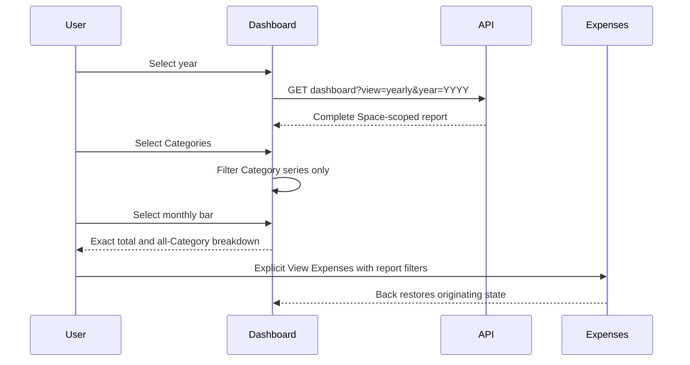

# Implementation Plan: Complete and Verify the Yearly Dashboard

**Implementation ID:** IP-03  
**Issue:** [#150](https://github.com/yororo/spendeazy/issues/150)  
**Prepared:** 2026-10-29 against local revision `1aa11b7`, including inspected working-tree changes.  
**Status:** Planned; no implementation, passing-check or native-acceptance claim.

## 1. Overview

- **Objective:** Complete the existing Yearly Dashboard's design alignment and prove calendar-year/YTD financial behavior and native journeys against the API/PostgreSQL.
- **Scope:** Year selection, summary disclosure/meters, Monthly frequency and annual utilization rows, charts, Category selection, drill-through/restoration, targeted reporting coverage and owning documentation.
- **Constraints:** Reuse the existing reporting endpoint, adapter, SVG charts, shared surfaces/header/Space accessory and modal primitives. Change the API only for a demonstrated gap. Preserve Monthly reporting. No production Statement Import preview/confirmation, Budget history, daily proration, new chart library, schema redesign or retired web work.

Authority, in precedence order: issue #150 and later accepted resolutions in [#140](https://github.com/yororo/spendeazy/issues/140); [reporting resolution](https://github.com/yororo/spendeazy/issues/128#issuecomment-6339633472); [screen flows](https://github.com/yororo/spendeazy/issues/127#issuecomment-6338502235); [design resolution](https://github.com/yororo/spendeazy/issues/129#issuecomment-6342611477); [acceptance policy](https://github.com/yororo/spendeazy/issues/133#issuecomment-6378625290) and [final amendment](https://github.com/yororo/spendeazy/issues/133#issuecomment-6378747788). The shipped HTTP surface is [api/docs/openapi.yaml](../../api/docs/openapi.yaml). Use [GLOSSARY.md](../../GLOSSARY.md) for terminology.

## 2. Current State

Verified by inspection; existing assertions have not been executed for this plan:

| Owner | Existing behavior / remaining gap |
| --- | --- |
| `mobile-app/src/features/dashboard/use-dashboard-report.ts` | Separate remembered Monthly end-month and Yearly state; session/Space-scoped report resource; Category selection currently changes the report request. No explicit year-selection action or foreground rollover refresh. |
| `mobile-app/src/features/dashboard/dashboard-view.tsx` | Shared Summary, checks and charts. Year arrows remain. Plan details are inline; summary meter becomes entirely negative above plan. Monthly dots already represent aggregate counts and handle zero eligible months. Annual checks are text actions to Category configuration, without utilization bars or explicit Expenses action. All Categories appear in a horizontal toggle list. |
| `mobile-app/src/features/dashboard/dashboard-charts.tsx` | Scrollable SVG bars/Category lines, monthly plan and supplied Monthly Budget references. SVG content ignores pointer events and is hidden from accessibility; exact values/drill-through currently rely on separate value lists. All Category point markers are circles. |
| `mobile-app/src/app/(app)/(tabs)/index.tsx`, `mobile-app/src/app/(app)/dashboard-expenses.tsx` | Push Expenses with source Space/date/optional Category filters; guard applying old-Space filters. Category checks push `/category-editor`; import count opens `/statement-import-history`. |
| `mobile-app/src/components/screen.tsx`, `choice-sheet.tsx` | Shared scroll/safe-area and native modal shells. Screen exposes no scroll restoration interface. Modal dismissal exists; explicit trigger focus restoration needs verification/implementation. Both files have unrelated local edits to preserve. |
| `api/src/reporting/application/dashboard-report.service.ts`, `dashboard-report-input.ts` | Exact rational planning/status calculations, Manila YTD/full-year ranges, future-year rejection, summary independence from Category filtering, monthly totals and Category/month values, annual checks with filters. Category filtering removes unselected Category series from the response. |
| `api/src/reporting/infrastructure/typeorm-dashboard-report-store.ts` | Space-scoped reads in a repeatable-read transaction; excludes soft-deleted Expenses; reads current Category/Budget configuration and confirmation timestamps. |
| `api/test/dashboard-reporting-http-postgres.e2e-spec.ts`, `api/src/reporting/application/dashboard-report.service.spec.ts` | Existing July 3 fixture, exact planning, chart-filter independence, Expense inclusion/deletion and import metadata; service coverage includes past years, future rejection and highest-Category ties. Yearly database coverage needs expansion. |

Design nodes were read through Pencil in `mobile-app/design/mobile-design.pen`: `VvvB3` (390-unit light Yearly board), `jaqBA`/`W8UYh6` (mode/year controls), `QtZkz` (information control), `sJKV1`/`oUFRH` (summary), `aXuG0` (frequency), `rNiyc`/`UYKIg` and `u91Za`/`SYiAK` (annual rows), `U0W2qG`/`bqcvI` (charts), `ppce3` (Category chooser). Some nodes retain six-month/USD/browser examples; accepted PHP/YTD/native behavior overrides those examples. Dark mode is an adaptation, not a supplied board.

## 3. Proposed Solution

Keep server financial decisions authoritative. Fetch the complete report without `chartCategoryId` for Dashboard presentation; retain that existing query option/contract for other callers and regression tests. Derive visible Category series locally, leaving the complete report available for monthly breakdowns. This avoids extra requests and prevents Category selection from restricting bar details, summary, checks or imports.

Keep workflow state in the Dashboard controller and navigation in the route. Views own only transient sheet/focus state. Scope period/Category/scroll state to the current identity and Space; remember mode selections within that scope. Use the existing session cancellation/current-scope protection for late results. Refresh on return from configuration and when resuming across a Manila date/year boundary.

Use native sheets/disclosures for year selection, About this summary, Category search/multiselect and exact chart details. Preserve 48-unit targets, body/metadata minima of 14/12, text scaling and safe areas even where the illustrative design is smaller. Reuse semantic tokens in `mobile-app/src/constants/theme.ts` and recipes in `mobile-app/design/design-token.md`.

For over-plan/annual meters, normalize against `max(actual, plan-or-limit)`: retain the lavender budget portion and append coral only for the excess. Below plan, show spending against the track. At zero plan, show “No plan set”, no percentage/remaining claim and a defined empty comparison meter. Use API comparison/status and exact amounts for meaning; floating-point conversion is permitted only for bounded drawing coordinates.

Research basis: [Expo SDK 58 Router](https://docs.expo.dev/versions/v58.0.0/sdk/router/) supports existing route navigation; [React Native accessibility](https://reactnative.dev/docs/accessibility) provides labels, selected state and modal background exclusion; [native Modal](https://reactnative.dev/docs/modal) documents Android Back dismissal. Reuse these installed facilities and verify focus on both platforms rather than assuming modal accessibility from visual appearance.

## 4. Implementation Tasks

### Task 1: Establish Yearly financial and boundary coverage

- **Goal:** Identify genuine server gaps before changing behavior.
- **Location:** `api/test/dashboard-reporting-http-postgres.e2e-spec.ts`; `api/src/reporting/application/dashboard-report.service.spec.ts`; reporting service/input/store listed above only if tests reveal a defect.
- **Changes:** Extend the existing assembled HTTP/PostgreSQL suite and fixture helpers, using a controllable injected `MANILA_CLOCK`. Cover the financial matrix in section 5 through independent expected values. Exercise current configuration edits/removal/deactivation/reactivation through existing Category configuration HTTP commands where applicable, then fetch the same historical Yearly report. Keep authorization and cross-Space assertions. Fix only demonstrated reporting defects; update response DTOs, generated OpenAPI and the mobile decoder together only if the contract changes. No migration is expected.
- **Verification:** Run the focused service and database suites with an explicitly isolated database; required database tests must execute rather than skip. Record actual failures and their fixes. Existing passing assertions are insufficient evidence for added scenarios.

### Task 2: Add compact year selection and scoped restoration state

- **Goal:** Select YTD/past years and retain each mode's context safely.
- **Location:** `mobile-app/src/features/dashboard/use-dashboard-report.ts`, `dashboard-view.tsx`, `dashboard-format.ts`; `mobile-app/src/app/(app)/(tabs)/index.tsx`; shared `screen.tsx` only for a small optional scroll interface if needed.
- **Changes:** Replace Yearly arrows with the adjacent dropdown (`jaqBA`/`W8UYh6`); retain working Monthly period selection. Add an intent-based `selectYear` controller action, guarding future years using API Manila `today`. Label the current year `YYYY · YTD`; expose exact inclusive dates and explicit “In progress”. Remember Monthly and Yearly choices separately without switching Space. Fetch and retain the full report; derive Category series independently. Reset financial selections, transient detail and scroll on Space/identity change. Preserve state and scroll across pushed drill-through routes; add restoration plumbing only where native verification shows the mounted screen does not retain it. Refresh on route focus after Budget changes and on foreground/day rollover; a previous current year becomes a complete past year after rollover, with the new current year offered.
- **Verification:** Switch modes/year repeatedly, select a past year, reject future selection, return from Expenses/configuration, and resume across Manila New Year. Delay an old-Space request while switching Spaces and verify neither old values nor filters appear. Add focused controller/rule coverage for these core transitions using existing test conventions; register new tests in `mobile-app/package.json` if necessary.
- **Dependency:** Task 1 identifies any contract changes; otherwise this task needs no API modification.

### Task 3: Complete Summary disclosure and cumulative meter

- **Goal:** Match hierarchy while explaining exact range and planning basis.
- **Location:** `mobile-app/src/features/dashboard/dashboard-view.tsx`, `dashboard-format.ts`; `mobile-app/src/components/choice-sheet.tsx`; theme tokens as needed.
- **Changes:** Implement “About this summary” from `QtZkz` using a native disclosure: exact dates, Asia/Manila, current active Budget configuration applied retrospectively, started months counted in full, Monthly and annual equivalents. Support close/backdrop/Android Back and restore accessibility focus to the trigger after dismissal. Show Expense count with its Expenses action. Implement the segmented meter described in section 3 with exact API variance text. Preserve actuals, highest Category and canonical confirmation-time import metrics independently of chart selection. Use PHP and Expense terminology.
- **Verification:** Check below/equal/above/zero plan and empty reports. Verify the lavender portion survives overage, no invalid geometry occurs at zero, and changing Category selection leaves all Summary values unchanged. Check TalkBack/VoiceOver focus/background exclusion and dismissal.
- **Dependency:** Task 2 report/state model.

### Task 4: Align Monthly frequency and annual utilization rows

- **Goal:** Match compact checks while preserving actual Budget semantics and navigation.
- **Location:** `mobile-app/src/features/dashboard/dashboard-view.tsx`; Dashboard route callbacks; shared meter presentation extracted within the Dashboard feature if useful.
- **Changes:** Compact Monthly rows using `aXuG0`, retaining aggregate dots equal to `eligibleMonths` and filled dots equal to `overBudgetMonths`; January shows a dash and “No completed months”. Do not hardcode the illustrative three rows or six dots. Add annual rows/bars from `rNiyc`/`u91Za`: actual amount, full annual limit, API textual status, utilization/overage context and distinct coral excess. Use supplied `expenseFilter` for an explicit View Expenses action; keep separate Category/Budget configuration access. Monthly frequency continues to open configuration; do not invent a contiguous breach-date filter.
- **Verification:** January, YTD and past-year denominators; normal/nearing/at-limit/over annual rows, including a 400.01 actual against 400.00. Verify configuration and Expenses are distinct accessible actions and use the intended Category/year.
- **Dependency:** Tasks 2–3.

### Task 5: Implement compact searchable Category multiselect and stable identity

- **Goal:** Keep the chart readable while supporting all eligible Categories.
- **Location:** `mobile-app/src/features/dashboard/dashboard-view.tsx`, `use-dashboard-report.ts`, `dashboard-charts.tsx`; reuse `choice-sheet.tsx`, existing fields/buttons and Category catalog.
- **Changes:** Display at most three Category chips (all available when fewer than three), collapse additional selections into `+N`, and add the `ppce3` searchable multiselect sheet. Announce “Choose categories, X of Y selected”, each selected state, and changes. Retain historical inactive Categories present in the report. Search changes choices only. Apply selection locally only to Category series and matching Monthly reference lines. Keep Category color and a stable distinguishable marker shape keyed by Category ID across chips, points and legends, including shared-color Categories. Preserve a clearly labeled All action and the existing empty-ID-selection meaning of All; default to three stable available Categories on first initialization when present, without overwriting later user choices or resetting on refresh.
- **Verification:** More than three selections, search/no matches, inactive history, duplicate colors, fewer than three choices, switching modes, refresh and Space reset. Assert Summary, full monthly totals, planning, Budget checks and imports remain unchanged.
- **Dependency:** Task 2 complete report and Task 3 accessible modal behavior.

### Task 6: Add chart detail interactions and verify all destinations

- **Goal:** Make the default chart-focused layout actionable and accessible.
- **Location:** `mobile-app/src/features/dashboard/dashboard-charts.tsx`, `dashboard-view.tsx`; `mobile-app/src/app/(app)/(tabs)/index.tsx`, `mobile-app/src/app/(app)/dashboard-expenses.tsx`; `dashboard-expense-navigation.ts` and its tests.
- **Changes:** Align chart hierarchy with `U0W2qG`/`bqcvI`. Render Jan–current started month for YTD and all 12 months for past years. Add accessible month hit targets aligned with the plot/scroll coordinates, including zero-value bars; activation opens exact monthly total/count and all-Category breakdown from the complete report, plus an explicit View Expenses action. Category/month activation exposes its exact value/reference and drill-through. Keep extended value lists collapsed. Preserve supplied Monthly Budget references; never plot Yearly/12 as a Category cap. Allow horizontal scrolling and scalable labels without losing alignment. Dismiss stale details when year/Space changes.
- **Verification:** Execute every navigation row below, then native Back; verify year/mode, Category selection and Dashboard scroll. Test the January zero bar, current partial month, December in a past year, large text, touch and screen-reader activation. Extend existing navigation tests only for meaningful changed filter/Space guards.
- **Dependency:** Tasks 2, 4 and 5.

| Origin | Destination and exact filter |
| --- | --- |
| Actual amount / Expense count | `/dashboard-expenses`, current `sourceSpaceId`, report `range.fromDate`–`range.toDate`, no Category |
| Highest Category | `/dashboard-expenses`, supplied highest-Category `expenseFilter` plus source Space |
| Monthly bar disclosure: all Expenses | `/dashboard-expenses`, selected monthly point `expenseFilter` plus source Space |
| Monthly breakdown Category / Category month point | `/dashboard-expenses`, selected month dates (through today if current) plus that Category ID and source Space |
| Category period total | `/dashboard-expenses`, report dates plus Category ID and source Space |
| Annual row: View Expenses | `/dashboard-expenses`, supplied annual check `expenseFilter` (full annual usage range) plus source Space |
| Monthly row / annual configuration action | `/category-editor`, current `spaceId` and relevant `categoryId`; retain existing archived-Space restrictions |
| Statement Import count | `/statement-import-history` in selected Space; preserve canonical count/filter metadata and existing unfiltered history route behavior |

### Task 7: Execute checks and native acceptance, recording gaps honestly

- **Goal:** Supply evidence distinct from implementation status.
- **Location:** Existing API/mobile suites; [native runbook](../../docs/local-testing.md); proposed `agents/implementations/IP-03-issue-150-verification.md` evidence record.
- **Changes:** Run section 5's checks and journeys against actual API/persistence. Record app/API revisions including dirty state, commands/results, isolated database suite execution, device/OS/build/profile, fixture/clock setup, observed expected/actual values and sanitized screenshots where appropriate. Compare light mode with `VvvB3` and document dark adaptations. Leave unavailable or failed cases pending with the concrete reason. Do not create production import functionality to obtain metrics evidence; reuse sanitized committed-import fixtures.
- **Verification:** Each issue acceptance area has a result or explicit pending entry. An unauthenticated launch, inspected code or static/unit pass cannot establish native Dashboard acceptance.
- **Dependency:** Tasks 1–6.

### Task 8: Update owning documentation and prepare delivery

- **Goal:** Leave a reviewable implementation and evidence handoff.
- **Location:** `mobile-app/design/design-token.md`; `api/README.md` if coverage/behavior changes; OpenAPI procedure in `api/README.md` if a contract gap required changes; IP-03 evidence record.
- **Changes:** Update source-node mappings, Yearly interaction/state behavior, dark departures and evidence links in the owning documentation. Mobile descriptions of server behavior cite OpenAPI rather than API implementation paths. Preserve unrelated staged/unstaged changes. During later implementation follow issue #150's task-branch/check/pushed-commit/PR workflow and active repository/skill instructions; link #150 and attach any created PR. Merge only with authorization. This planning request authorizes only creation of this plan, not commits, pushes or PR publication.
- **Verification:** Review scoped diff and acceptance/evidence mapping; ensure delivery claims match the tested revisions and unresolved cases remain explicit.
- **Dependency:** Task 7, with final documentation reflecting actual results.

## 5. Testing and Validation

Add critical-path cases to existing suites; avoid snapshot/style tests or duplicate calculation implementations:

| Case | Independent expected outcome |
| --- | --- |
| Accepted July 3 fixture | Home 1,200/month + Groceries 400/month + Transport 200/month + Travel 2,400/year: 2,000.00 monthly equivalent, 14,000.00 YTD Planned, 24,000.00 annual equivalent. Travel still compares against 2,400.00. |
| Annual exactness | A sole 1,000/year Budget displays 83.33 monthly equivalent; past-year Planned and annual equivalent are exactly 1,000.00, not 999.96. Assert exact fields too. |
| Status thresholds | Against 400.00: 319.99 normal, 320.00 nearing, 400.00 at limit, 400.01 over; Monthly equality is not a breach. Final money half-up to two decimals, percentages to one. |
| Calendar bounds | Jan 1 YTD has one represented month and zero completed-month eligibility. Past year has all 12 months and ends Dec 31. Inject instants immediately before/at `2026-12-31T16:00:00Z` (Manila Jan 1, 2027); verify range, eligibility, import confirmation bounds and future-year rejection. |
| Current configuration | Re-query a fixed historical year after Budget amount/recurrence edits, removal, deactivation and reactivation: planning/checks use the new current settings; actual Expenses remain unchanged. |
| Actuals and ties | Include inactive/unbudgeted Categories, exclude deleted Expenses, select alphabetical highest Category on equal actuals with deterministic identity tie-breaking; no Expenses means null highest Category. |
| Independence / import provenance | Category query/selection changes only Category series. Summary, monthly totals, checks and imports remain exact. Imports count by Manila confirmation time; statement dates and later Expense edits/deletion do not rewrite count/latest confirmation. |
| Zero/empty/isolation | Zero Planned has no percentage and no division error; empty year still has appropriate month points. Another Space's Expenses, Categories, filters and late results never appear. |

Implementation-time commands (not run for this planning-only deliverable):

- From `mobile-app/`: `npm run lint`, `npm run typecheck`, `npm test`.
- From `api/`: `npm test -- --runInBand --runTestsByPath src/reporting/application/dashboard-report.service.spec.ts`; focused database run: `npm run test:e2e -- --runInBand --runTestsByPath test/dashboard-reporting-http-postgres.e2e-spec.ts` with `TEST_DASHBOARD_REPORTING_DATABASE_URL` explicitly configured.
- Final API checks: `npm test -- --runInBand`, `npm run build`, read-only `npx eslint "{src,apps,libs,test}/**/*.ts"`, `npm run openapi:check`, and `npm run test:postgres`. The inspected PostgreSQL launcher requires ten distinct database URLs, including Dashboard Reporting and the historical migration target; use its current validation rather than the stale nine-URL guidance. Provision disposable automated databases explicitly; never point these suites at the retained manual database.
- If contract changes are necessary: `npm run openapi:generate`, inspect the generated diff and re-run the consistency check plus adapter tests.

Native acceptance on Android emulator and physical iPhone: select YTD/past years; switch modes; refresh; load/error/retry; inspect all summary/check/chart disclosures; follow every navigation row; return with native Back; edit configuration and return; switch Personal/Shared Spaces with an in-flight request; exercise rollover/resume with a documented test clock setup. Verify persistence-backed exact values using fictional fixtures. Assess light/dark/System, 320/360/390 logical widths where configurable, landscape, large text, safe areas, keyboard/search clearance, readable no-blur fallbacks, 48-unit controls and TalkBack/VoiceOver order, selected/count announcements, background exclusion and focus restoration. Financial values update immediately; preserve reduced-motion behavior.

## 6. Acceptance Criteria

- Compact year controls and exact range/YTD/In progress disclosure behave as specified; future years are unavailable and rejected by the API.
- Summary and annual bars preserve lavender allocation with separate coral excess; exact text and zero-plan behavior are correct.
- Monthly dots/counts use eligible completed months; annual checks use full limits and expose both Expenses and configuration actions.
- Three visible Category chips, collapsed extras and searchable multiselect preserve identity and only affect Category series; chart details remain complete and accessible.
- YTD and past-year charts show the correct months/references and exact disclosures; all destination filters and Back restoration pass without cross-Space leakage.
- Financial matrix passes over HTTP/PostgreSQL; native evidence covers actual API/persistence and design/accessibility checks. Implementation status and unavailable evidence are recorded separately; acceptance remains pending until required evidence exists.
- Owning documentation and any justified OpenAPI change are consistent with tested behavior, with no unrelated application changes.

## 7. Assumptions and Open Questions

- **Year availability:** The current response exposes no data-bearing year inventory or earliest supported year metadata. Assume “available” means valid nonfuture calendar years, including empty past years, rather than only years with Expenses. Use a lazily extended/searchable descending year list with four-digit positive years and no arbitrary recent-years cutoff. If product intent requires data-bearing years only, identify that as a concrete metadata gap before extending the endpoint; do not infer availability from the currently loaded report.
- **Category initialization:** Use three deterministic available Categories in existing report order for the initial chart selection, as the design describes; preserve explicit user selection thereafter. Empty IDs continue to mean All, matching the existing contract. No requirement for a persistent cross-restart Dashboard preference is assumed.
- **Import navigation:** The accepted screen flow opens import history; the existing route has no date-filter input. Retain this destination and do not imply that the history list is restricted to the Summary period. Counts/latest timestamps still follow the supplied confirmation-time reporting filter.
- **Workspace and tooling:** Existing edits are unrelated and must remain intact. Several guidance links (`docs/local-checks.md`, `mobile-app/README.md`) are absent locally; do not invent commands from those links. Follow the inspected package scripts, PostgreSQL runner and existing native runbook, recording missing infrastructure if it blocks execution.
