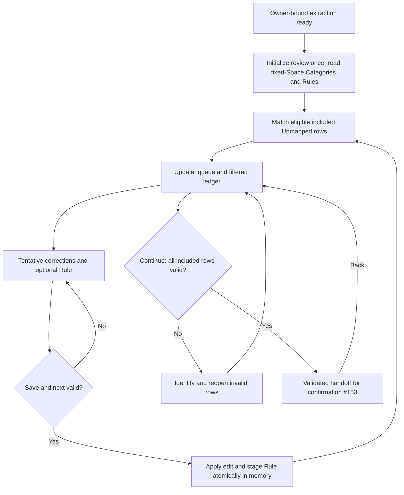

# Implementation Plan: Transaction review and staged Category Rules

## 1. Overview

- **Objective:** Implement [issue #152](https://github.com/yororo/spendeazy/issues/152): the Statement Import Update step, consuming #151's extraction result and handing a validated local draft to #153.
- **Scope:** Mobile review state, Category/Rule reads, deterministic matching, queue/ledger controls, corrections, exclusion/restoration, local Rule staging and confirmation handoff. No API/schema changes, persistent Rules, Expenses, Activity or Statement Import writes. Confirmation previews/acknowledgments/atomic save belong to #153; uncertain-save recovery to #154; history/detail to #155; parser certification to #138.
- **Constraints:** Original User, Space and draft identity stay fixed. Preserve original evidence independently of edits. PHP/date-only values; Manila date validation; active same-Space Categories, including those without Budgets. Memory-only work; no raw PDF/password retention, remote suggestions, durable draft or automatic submission. Follow root/mobile AGENTS.md, mobile CODING_STANDARDS.md and GLOSSARY.md.
- **Authority:** #152 and [#140](https://github.com/yororo/spendeazy/issues/140), including the [accepted import resolution](https://github.com/yororo/spendeazy/issues/131#issuecomment-6341770311), override illustrative design behavior.
- **Design authority:** Follow [`mobile-app/design/mobile-design.pen`](../../../mobile-app/design/mobile-design.pen) as the authoritative visual design, specifically **Import / Update** (`oqOst`) and its referenced child nodes. Use [`mobile-app/design/design-token.md`](../../../mobile-app/design/design-token.md) for shared component recipes and the documented dark adaptation. Accepted issue decisions and accessibility requirements override illustrative mockup behavior.

## 2. Current State

Paths are repository-relative; new modules below are explicitly proposed. Inspected base: `f36e455` on 2026-10-29. Plans 01–04 reside in `docs/agents/implementation/`; this plan follows the invoked skill's plural `implementations/` output directory and continues numbering at 05.

- #151 production code exists under `mobile-app/src/features/statement-import/`. `index.ts` exposes `statementImportStore`, evidence types and `decimalAmount`. `ImportResult` includes owner/draft/file identity, ordered rows, original values, classification/direction evidence, controls, page outcomes, completeness, reconciliation and warnings. It uses bigint centavos; do not JSON-serialize it directly.
- `import-state.ts` and `import-store.ts` currently cover extraction only. `ready.result` is the handoff; authentication suspension retains evidence. `application/session.ts` owns the store, preserves same-User work, clears sign-out/different identity and rejects Space changes while import work exists. `application/spaces/provider.tsx` already exposes import unsaved-work protection. Review must join this ownership rather than introduce an unrelated route-local store.
- `(app)/import-statement.tsx` composes Select file and recent history. `import-view.tsx` ends at Extraction ready with an unavailable-review explanation. The route is outside `(tabs)` in `(app)/_layout.tsx`, so tabs/Add are already absent.
- `api/categories-api-client.ts` supplies `listCategories(spaceId)` and `getCategoryRules(spaceId)` with a Space Rule collection revision and Rule IDs/Category IDs. Its `CategoryRule` type permits missing IDs; production matching must reject unusable entries rather than guess ownership. `use-space-categories.ts`, `application/session-resource.ts` and `authorized-client.ts` provide scoped read/retry patterns.
- `prototypes/parser-proof/rules.ts` demonstrates Exact precedence and distinct-Category ambiguity, but defaults to fictional Rules and uppercase normalization. Production must use real reads and the API's lowercase convention: trim, collapse `/\s+/gu` to one space, then `toLowerCase()`, without punctuation removal or Unicode compatibility normalization. Verified against `api/src/normalization/matching-text.ts` and Category Rule validation. Rule identity is `(matchType, normalizedPattern)`; patterns allow 1–500 Unicode code points with non-whitespace content. Space reads include inactive Categories' Rules: these still reserve conflict keys even though they do not participate in matching.
- `features/expenses/manual-draft.ts` exports `prepareManualExpense` and `todayInManila`; reuse its exact amount, description, calendar and active same-Space validation. `expense-fields.tsx`, `CategoryMark`, `DesignSurface`, buttons, fields and `ChoiceSheet`/`CenteredDialog` supply existing UI recipes.
- Pencil inspection verified Update `oqOst`, progress `ZskHc`, source summary `V1X4wR`, queue `QXkur`/`KNUes`, Remember controls `Pb6TA`, ledger `Wn9Yt` and Continue `bq2mA`. Mockup tabs, USD, fixed heights and permissive continuation are superseded. #151's report `docs/agents/implementation/IP-04_TASK-05_Report.md` records automated/provider Android evidence and outstanding native/iPhone gates; do not assume full parser acceptance.

## 3. Proposed Solution

Extend the existing application-owned import store with a separate review model, initialized exactly once per `ImportResult.draftId`. Keep the extraction result unchanged. Add feature-owned pure review rules/reducer, a scoped controller and presentation, with thin route composition. No new dependency is needed.

The proposed review model contains:

- An immutable reference to original `ImportResult`; row edits keyed by `sourceRowId`, retaining source order and duplicate-looking rows.
- Applied editable values (amount text/exact decimal on validation, description, date, Category), inclusion decision, and assignment origin (`manual` or `rule`, with Rule context). Ineligible source classifications remain locked; do not infer eligibility from edited amounts/descriptions or override unknown direction.
- A tentative editor buffer, separate queue cursor/deferred IDs and ledger filter. Keep entered text in memory even when temporarily invalid. Persist the editor buffer through Back/backgrounding; explicit Skip abandons its unapplied edits.
- Real Category/Rule snapshots with destination, Category revisions, Rule IDs and collection revision; staged Rules with local identity, pattern/mode/Category and the revision context against which they were checked. Loading/errors do not replace review state.
- A monotonically changing review revision and a validated confirmation handoff. Any applied review change invalidates the previous handoff; tentative changes must be applied or explicitly abandoned before Continue.

Match only included, eligible, Unmapped rows against active destination Categories. Collect Exact matches first; consult Contains only when there are no Exact matches. One distinct Category assigns it; zero/multiple stay Unmapped. Contains is a literal normalized substring, including within a word. Never use regexes, word boundaries, fuzzy matching or suggestions. Preserve all manual assignments. Initial matching runs after reads; newly staged Rules affect other Unmapped rows, never excluded activity or already mapped rows.

`Save & next` validates the editor, checks the optional Rule and atomically applies both locally. A conflict applies neither. Same-Category normalized duplicates are no-ops; a different Category owning the same key blocks Rule staging, including inactive owners. Different modes with the same pattern are distinct keys. Overlapping different keys are allowed and resolved through normal match ambiguity. Skip and Exclude stage nothing. Exclude changes inclusion only, discards tentative edits, retains prior applied values and keeps the row in the ledger. Restore is available only for user-excluded eligible spending and returns it with its prior applied values; if Unmapped, it re-enters the queue and can match current Rules.

Official research checked 2026-10-29: [React useSyncExternalStore](https://react.dev/reference/react/useSyncExternalStore) requires immutable snapshots with stable identity between changes, fitting the existing store; [Expo SDK 58 Router](https://docs.expo.dev/versions/v58.0.0/sdk/router/) supports the existing file-based stack and SDK 58 entry points; [React Native FlatList](https://reactnative.dev/docs/flatlist) requires stable keys and externally retained state for virtualized rows. Use `sourceRowId` keys and keep editing state outside row components. Retain SDK 58 and installed APIs; no upgrade is implied.

## 4. Implementation Tasks

### Task 1: Extend import ownership with immutable review state

- **Goal:** Preserve review and original evidence through the established lifecycle.
- **Location:** Existing `mobile-app/src/features/statement-import/import-model.ts`, `import-state.ts`, `import-store.ts`, `index.ts`; `mobile-app/src/application/session.ts`; proposed feature `review-model.ts` and `review-state.ts`.
- **Changes:** Define the review model above and initialize only from the current ready result with matching owner/Space/draft. Extend state with review/confirmation-boundary phases; retain review plus tentative editor in suspension and recovery, rather than retaining only `result`. Keep extraction transitions and adapter cleanup intact. Review commands must check current authentication, draft identity and fixed destination; mutations/Continue additionally require writable destination. Fence asynchronous reads by session generation, draft and request identity. Do not reset review on route remount or successful retry. Explicit discard/sign-out/different User clears evidence, edits, buffer, staged Rules and handoff together. Archived work remains inspectable; disable mutation/Continue without remapping it. Preserve existing Space unsaved-work behavior and manual Expense behavior.
- **Verification:** Extend `import-state.test.ts`, `import-workflow.test.ts` and `application/session.test.ts` for initialize-once, original evidence unchanged, Back/remount retention, same-User suspension/resume, stale requests, discard, sign-out/identity change, blocked Space switch and archive inspection. Existing extraction tests must pass.

### Task 2: Load the fixed-Space catalog and implement production matching

- **Goal:** Correct local matching using current destination data.
- **Location:** Existing `mobile-app/src/api/categories-api-client.ts`, `application/session-resource.ts`, `features/expenses/use-space-categories.ts` as reusable adapter/lifecycle references; proposed import `review-rules.ts` and scoped catalog/controller code.
- **Changes:** Fetch Categories and complete Rule collection for `result.owner.spaceId`, using authorized scoped requests. Accept them as one usable catalog only after both reads succeed; retain prior work on loading/failure and expose retry. Treat Rules missing usable identity/Category links as a catalog error. No per-Category Budget requests are needed. Keep all Rule keys for conflict checking, but match only Rules targeting active listed Categories. Implement lowercase normalization, Exact-before-Contains, literal substring and distinct-Category ambiguity as specified. Retain assignment origin and manual choices. On refresh, flag assignments to inactive/missing Categories as invalid and route them to resolution; never silently choose a new Category for a manual assignment. Newly Unmapped rows may be matched; valid applied mappings remain stable. Refresh failures retain editable values and block new assignments, Rule staging and Continue until a usable catalog is restored.
- **Verification:** Focused fictional tests for case/whitespace, punctuation, substring within a word, Exact precedence, multiple Rules for one Category versus conflicting Categories, inactive/missing Categories, valid Category without Budget, manual preservation, excluded-row immunity and stale/failed/retried catalog loads.
- **Dependencies:** Task 1.

### Task 3: Implement queue, ledger edits and atomic local Rule staging

- **Goal:** Make Update interactions deterministic and reversible within the living draft.
- **Location:** Proposed `review-state.ts`, `review-rules.ts`, `use-statement-import-review.ts`; existing `features/expenses/manual-draft.ts` and import `values.ts`.
- **Changes:** Derive queue membership from included eligible rows lacking a valid active assignment; preserve source ordering. Selecting a Category/typing corrections only updates the tentative editor. Save & next reuses `prepareManualExpense` with fixed-Space Categories and an injected clock; canonicalize amounts exactly and apply editor fields plus optional Rule in one reducer event. Remember defaults off for every newly opened row; opt-in reveals Exactly/Contains and required nonblank pattern, initially the current description with Exact selected. Validate the 500-code-point limit and normalized conflict keys against persisted and staged Rules. Reuse same-Category duplicates without adding another staged mutation; never replace another Category's Rule. Store collection/Category revision and existing Rule identity context for #153. Apply newly staged Rules only to other included Unmapped rows.
  Skip discards tentative fields/Remember choices and advances, leaving the row Unmapped. Defer skipped rows for the current pass; when only deferred rows remain, show their outstanding count and a Review skipped action starting another source-ordered pass. Completion means zero included Unmapped rows, not merely reaching the end of a pass. Exclude/restore follow the rules in section 3. Derive All count from all source rows, Unmapped from included rows without valid assignments and Excluded from all omitted rows. Ledger filtering must not change queue cursor/editor. Explicitly opening a ledger row opens its review controls; retain a pending queue buffer separately until saved/skipped, and provide return to queue. Automatically excluded/unresolved rows open evidence/reason inspection only. Support manual correction of mapped rows as well as queue items; changed descriptions must not erase manual Categories.
- **Verification:** Reducer tests exercise tentative versus applied values, skipped-only pass, final queue completion, ledger filters with an active editor, reopen/correct mapped rows, exclude/restore and immutable automatic exclusions. Test Rule conflict applies neither assignment nor Rule, same-Category no-op, different modes, inactive-owner conflict, Skip/Exclude staging nothing and propagation preserving manual/mapped/excluded rows. Assert original rows/controls/warnings remain deeply equal.
- **Dependencies:** Tasks 1–2.

### Task 4: Build the native Update screen from the approved design

- **Goal:** Replace Extraction ready's unavailable-review state with usable Update.
- **Location:** Existing `mobile-app/src/app/(app)/import-statement.tsx`, `features/statement-import/import-view.tsx`, `use-statement-import.ts`; proposed feature review view/controller; existing `components/`, `features/expenses/expense-fields.tsx`, `design/design-token.md`.
- **Changes:** Compose Select versus Update from store phase in the existing stack route. Reuse progress, compact real provider/file summary, layered queue, Category marks/picker, Remember controls, ledger with live counts and primary Continue hierarchy from the verified Pencil nodes. Show original evidence and advisory warnings separately from edited amounts; no PDF-view action requiring a retained file. Use `ExpenseFields` in the existing modal shell for corrections and shared field/buttons/surface/theme recipes throughout. Add loading/error/retry, no active Categories, no eligible rows, deferred queue and completed queue states. A missing Category cannot be bypassed; Categories without Budgets remain selectable. Provide visible Back and Close: Back retains work, Close offers Keep editing / Discard and navigates away only after explicit discard.
  Keep tabs/Add hidden throughout. Use growing card heights and decorations behind content rather than mockup's fixed 455/405 heights. For a virtualized ledger, use one vertical FlatList with queue/header/footer content and a safe-area/keyboard shell adapted from Screen; do not nest it in Screen's same-direction ScrollView. A small reusable shell change is acceptable; preserve unrelated screens. Use source IDs and external editor state. Support light/dark, scalable text, safe areas and keyboard clearance, 48-unit targets, 52-unit primary actions, at least 14-unit body/input and 12-unit metadata, accessible selected/filter states, focus restoration and reduced motion. Record adaptations in design-token.md only where behavior changes.
- **Verification:** Android emulator and physical iPhone walkthroughs of queue, ledger filters, corrections, Remember, errors/retry, completion, Close and Back. Compare light hierarchy against `oqOst`; check dark contrast, narrow widths, large text and screen-reader focus. Verify tabs/Add remain absent and signed-in remount restores work.
- **Dependencies:** Tasks 1–3.

### Task 5: Validate Continue and expose the #153 boundary

- **Goal:** Hand confirmation a complete validated local draft with no writes.
- **Location:** Proposed review validation/handoff functions in feature-owned modules; existing `features/statement-import/index.ts`, route composition and feature `README.md`.
- **Changes:** Continue validates every applied included row, not only queue completion. Require at least one included eligible row, exact positive PHP amount, nonblank description, valid nonfuture Manila date and active same-Space Category. Block while a tentative buffer has unapplied changes, with actions to Save & next or abandon them explicitly; never silently apply on Continue. Show row-specific errors and a direct reopen action even when the ledger's current filter hides the row. Recheck current owner/draft/access/catalog, including staged Rule conflicts and inactive targets. Warnings remain visible/advisory, not acknowledgment or override controls owned by #153.
  Expose an immutable handoff containing owner/Space/draft/review revision, unchanged original `ImportResult`, source-ordered applied row values and inclusion decisions, assignment context, staged Rule intents and catalog/Rule revision context. Decimal-string output must preserve exact amounts; retain bigint evidence internally until #153 defines serialization. No operation receipt, preview/save request or persistent mutation. Back from the handoff preserves review, queue, filter and buffer; applied changes invalidate it. If #153 is still absent, publish a tested feature handoff and show an honest read-only Review ready boundary with Back to review; do not route to a nonexistent Confirm screen or imply success. #153 later consumes the same interface and owns write-time freshness/validation.
- **Verification:** Handoff tests cover no included rows, zero/negative/overprecision amounts, blank text, impossible/leap/future dates around Manila midnight, inactive/wrong-Space Categories, invalid rows outside current filter, pending edits and stale Rule context. A valid mixed ledger passes exact reviewed values and all original evidence; Back/edit/revalidate updates the review revision. Adapter-spy integration asserts only Category/Rule GETs and zero persistence calls.
- **Dependencies:** Tasks 1–4.

### Task 6: Complete focused regression and native evidence

- **Goal:** Deliver reproducible validation with clear boundaries for subsequent issues.
- **Location:** Proposed review rule/state/controller tests; existing `mobile-app/package.json`, feature README, `docs/local-testing.md` where needed; implementation report alongside this plan.
- **Changes:** Register critical review tests in existing npm scripts and use sanitized, fictional `ImportResult` fixtures. Document the actual exported handoff and no-write boundary. Record automated results separately from native device/OS/build/revision evidence and unresolved gates. Carry forward #151/#138 limitations without certifying extraction completeness or file limits. No private statements/passwords/raw text or financial screenshots in Git.
- **Verification:** Run the commands and core journeys below; inspect diff for unrelated changes and evidence leakage. Do not mark missing physical-device checks complete.
- **Dependencies:** Tasks 1–5.

## 5. Testing and Validation

From `mobile-app/`: `npm test`, `npm run parser:test`, `npm run lint`, `npm run typecheck`. Add review tests to the existing Node test command; follow its pure TypeScript and mocked controller patterns. API/PostgreSQL suites are unnecessary for this mobile-only plan unless implementation reveals an actual API change requiring separate scope review.

Core fictional scenario: purchase PHP 1,000 plus outgoing transfer PHP 300 yields two included rows/PHP 1,300 after Category assignment; payment PHP 5,000, refund PHP 200 and cash-in stay visible/excluded. Corrections change reviewed totals without rewriting controls/reconciliation. Include an unresolved-direction row that remains locked and two identical-looking rows with distinct source IDs. Verify no endpoint creates records during any Update interaction.

Using `docs/local-testing.md`, run native Android-emulator and physical-iPhone checks with installed development builds: actual #151 handoff, all queue/ledger/Rule actions, catalog failure/retry, Back/reopen/background, same-User authentication recovery, explicit sign-out/different identity clearing, Space discard/restart and archive inspection. Restart loses the review draft. Check light/dark, 320/360/390 logical widths, large text, keyboard, safe areas, Android Back, screen-reader labels/focus and a longer ledger. Native evidence from #151 does not substitute for these review journeys. Rebuild only if native dependencies/configuration change; Expo Go is not the target.

## 6. Acceptance Criteria

| Observable completion condition | Tasks |
| --- | --- |
| Stable #151 owner/Space/draft/source identities and untouched original evidence; living review retained and cleared correctly | 1, 6 |
| Real fixed-Space active Category matching, no-Budget assignments, deterministic Exact/Contains and ambiguity, recoverable reads | 2 |
| Tentative selection; Save & next applies atomically; Skip defers; Exclude/restore eligible spending; truthful completion | 3 |
| Live All/Unmapped/Excluded counts, filter-independent queue, row reopening/corrections, locked automatic exclusions/unresolved direction | 3–4 |
| Remember defaults off; validated Rules staged locally with duplicate/conflict/revision semantics and safe propagation | 2–3 |
| Designed accessible Update in both Appearances; fixed destination, hidden tabs/Add and Keep editing/Discard | 4, 6 |
| Every included row validates; errors are actionable; original evidence plus reviewed values/Rules reach #153; Back retains work | 5 |
| Zero Expenses, Activity, persistent Rules or Statement Imports created by Update; no false confirmation/save success | 5–6 |

## 7. Assumptions and Open Questions

- #151 implementation is available locally despite #152's older placeholder baseline. Its native certification gaps remain with #138. This plan consumes its classification as authoritative; repairing noneligible/unknown-direction extraction requires extraction work rather than a review eligibility override.
- #153's production Confirm route does not exist at the inspected base. The explicit Review ready boundary is an integration seam, not delivery of #153. Full Confirm/Back native acceptance requires #153 integration; test the local round trip now.
- Queue deferral uses source-ordered passes with an explicit Review skipped action so repeated Skip cannot masquerade as completion. Remember starts in Exact mode with the current description; the pattern remains editable in either mode. These are proposed interaction defaults where the issue does not prescribe details.
- A successfully staged Rule remains a draft intent if its originating row is later excluded; it can still classify other included rows. Skip/Exclude never create a new Rule. Discard removes all staged intents. No bulk assignment, Rule editor/removal interface or Category creation inside Update is added by this issue.
