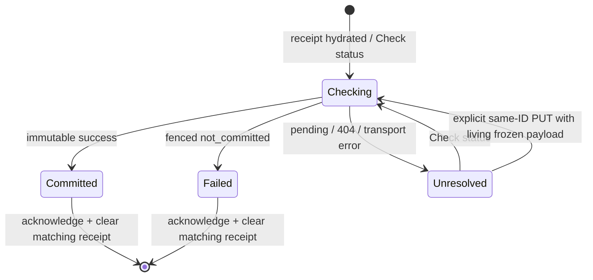

# Implementation Plan: Recover uncertain Statement Import outcomes

## 1. Overview

- **Objective:** Implement [issue #154](https://github.com/yororo/spendeazy/issues/154): resolve the original confirmation after response loss, timeout or restart without duplicate financial writes or persisted review drafts.
- **Scope:** Durable minimal device receipts, operation GET, lock-based terminal recovery, same-ID live retry, identity cleanup and native recovery presentation. Build on #151–#153; retain their atomic confirmation, evidence and warning behavior.
- **Constraints:** Plan only. Keep PDF/passwords, rows, Rules, amounts and frozen JSON out of recovery storage and logs. Preserve the original User/Space. No automatic PUT after restart, parser changes, new history/detail product, generic job system, processing lease or new dependency. Preserve the 1 MiB request limit; #138's envelope/device gates remain separate.

Authority: the issue and its accepted [operation protocol at the linked revision](https://github.com/yororo/spendeazy/blob/0a5983408507bdecb771ac16c5a440f82a5595e7/docs/specifications/mobile-expense-domain-api.md#operation-protocol). That specification file is absent from this checkout; it was read through GitHub. Shipped HTTP behavior remains defined by `api/docs/openapi.yaml`. All repository paths below are root-relative.

## 2. Current State

- `api/src/statement-imports/application/reviewed-import.service.ts` admits actor/Space/UUID/hash in a short transaction, then executes under User → exclusive Space → operation locks. Import, immutable rows, Expenses, Activity, remembered Rules/revisions and success result commit together. Application failures roll financial writes back to a savepoint and retain safe `not_committed` metadata; unexpected failures leave admission pending.
- `application/import-confirmation-store.ts`, `infrastructure/typeorm-import-confirmation-store.ts` and `infrastructure/typeorm-reviewed-import-unit-of-work.ts` own operation persistence and locking. `api/src/database/migrations/1990000000000-add-import-confirmation-evidence.ts` already protects immutable identities/terminal states and unique successful-import references. Operations contain no replay payload, lease or expiry. Only admission INSERT requires a writable Space; terminal metadata UPDATE can occur after archive.
- `presentation/statement-import-operations.controller.ts` exposes PUT with 201/200 success and 409 payload conflict. No operation GET exists. Successful replay checks original actor/read authority before writability and current Category checks.
- Mobile `confirmation-workflow.ts` freezes serialized JSON, acknowledgments and a separate confirmation UUID in memory. Its `ReceiptWriter` seam gates sending; `use-import-confirmation.ts` and the production route supply no durable writer. Generic 400/403/404/409/413/415 handling currently overstates certainty. Frozen generation binding also blocks same-User retry after authentication renewal.
- `mobile-app/src/application/session.ts`, `session-request.ts` and `authorized-client.ts` retain living work on expiry and fence obsolete requests. Explicit sign-out/different identity clear memory. Mobile ownership uses Clerk's User ID; API authentication resolves it to a local User ID. Do not compare those two ID formats.
- `application/spaces/workflow.ts` restores a remembered Space with Personal fallback; recovery must run before that fallback can select a different destination. `import-store.ts` locks review mutations, but restart has no review to lock.
- `expo-secure-store` and its app plugin are installed for Expo SDK 58. Existing `navigation/device-memory.ts` catches preference-storage errors; receipt storage must propagate failures. Shared `components/choice-sheet.tsx` supplies accessible modal/focus behavior.
- Design JSON confirms `nny4o` is Import / Confirm and `VgDBB` is the retry-save alert surface. The latter's “Couldn’t save” / retained-edits copy is unsuitable for unresolved/restarted imports. `design-token.md` already documents Confirm adaptations. IP-06's consolidated handoff records implemented #153 and pending native evidence; it also identifies ten required isolated PostgreSQL URLs, verified in the actual runner.

## 3. Proposed Solution

### Operation status and fencing

Keep #153's transaction-held locks as the processor fence. Add no clock-based takeover. GET reads terminal records immediately after authorization. For a known pending record, reconcile in a transaction by attempting the existing User → Space → operation locks without waiting on row locks, then rechecking membership and state. If execution holds a conflicting lock, return pending. If all locks are acquired and the record is still pending, persist a stable proposed `IMPORT_OPERATION_NOT_COMMITTED` failure before returning it: no financial transaction owns the scope, and every queued/delayed executor must re-read this terminal record before writing. A competing PUT may lose the admission-to-execution race to reconciliation; its correct outcome is the retained terminal failure, with no financial write.

This is recovery reconciliation of operation metadata within GET, never financial execution. Document it in the endpoint description. Roll back a failed NOWAIT transaction before translating only PostgreSQL lock-unavailable into pending; database disconnects/other errors remain unresolved errors. Terminal reads do not require execution locks or writable authority. Unknown IDs remain 404 and are never turned into failure tombstones: the original request might still arrive.

| GET result | Body / interpretation |
| --- | --- |
| 200 committed | Existing immutable `CommittedImportResultDto`, unchanged |
| 200 pending | `{status: pending, operationId}`; no financial data or processing deadline |
| 200 not_committed | `{status: not_committed, operationId, failure: {code, details, review?}}`; project existing safe failure metadata |
| 404 | Unknown or inaccessible scoped operation; unresolved, never permission to import again |
| 401 / transport / malformed response / other error | Protect session or show unresolved; no outcome inferred |

Use `Cache-Control: no-store` for GET. Keep PUT's current 201/200/409/error envelope and original terminal-error replay. Payload conflicts never release the original operation. Retain successful keys for the import lifetime and terminal failures until identity cleanup; no TTL or terminal-to-pending transition. An archived Shared Space permits original-actor status/replay with read authority; another member may inspect the import through history but cannot recover this operation.

The lock design follows PostgreSQL's documented [transaction-held row locks](https://www.postgresql.org/docs/16/explicit-locking.html) and [NOWAIT behavior](https://www.postgresql.org/docs/16/sql-select.html#SQL-FOR-UPDATE-SHARE). A timeout, old timestamp or presumed expired lease is never evidence of failure. If future lease ownership is introduced, it requires an additional fencing design; it is outside this implementation.

### Receipt and native lifecycle

Use one versioned storage key holding exactly `{userId, spaceId, operationId}` for the app's single outstanding confirmation. The key carries the format version; the value has no extra fields. Store the existing mobile owner identity (Clerk ID), original positive-decimal Space ID and confirmation UUID. Await SDK 58 [SecureStore.setItemAsync](https://docs.expo.dev/versions/v58.0.0/sdk/securestore/) before PUT; rejection prevents sending. Read/delete errors must remain visible and must not be interpreted as an empty receipt.

Serialize reads/writes/clears through one application-lifetime receipt owner. Use an identity epoch and receipt identity checks before and after asynchronous work; revoke the epoch synchronously on explicit cleanup. A clear waits behind any in-flight write and deletes afterward, so a late writer cannot restore cleared state. Do not allow another identity, new submission or startup restoration through a failed cleanup. Clear private memory immediately; await durable cleanup before reporting it complete and expose retry if it fails. Terminal acknowledgment deletes only its matching receipt, never a later operation's receipt.

Hydrate before starting another import or restoring the active Space. Defer inspection until authentication is resolved. A matching identity recovers against the receipt's original Space after provisioning/catalog load; select that exact accessible Space, including archive. If absent/inaccessible, keep the receipt unresolved and display its Space ID without Personal fallback. A different resolved identity clears prior private state before loading its own workflow. Unauthenticated expiry hides receipt/results and retains living review; it is not explicit sign-out.

Restart performs GET only. A live session may explicitly retry the same frozen bytes/UUID, including after same-User reauthentication; rebind the request's session generation while retaining operation identity/payload. Never reuse an old response's authority. Recovery lookup is independent of destination writability; archive disables financial retry but still allows status checks.

Checking/Unresolved keep the original operation and block a new independent import. Closing the surface retains receipt/block; unresolved dismissal first warns “Saving may still complete. Check import history in [original destination].” It hides the message, not the operation. A persistent recovery entry allows Check status again. Terminal acknowledgment clears the receipt; definitive failure unlocks living review for corrections with a new UUID. After restart, terminal failure explains that review data is unavailable and a new review is needed. Success completes/refreshes living work once; acknowledgment remains separate from success handling.

## 4. Implementation Tasks

### Task 1: Implement authoritative operation recovery

- **Goal:** Return stable original outcomes and safely terminalize orphaned admitted operations.
- **Location:** `api/src/statement-imports/application/reviewed-import.service.ts`, `reviewed-import-unit-of-work.ts`, `import-confirmation-store.ts`, `import-confirmation-errors.ts`; their existing TypeORM adapters; `api/src/errors/` and HTTP error mapping as required for the proposed safe failure code.
- **Changes:** Add a typed status use case and narrow nonblocking recovery-lock capability to the feature port. Implement section 3's authorize/read/lock/re-read/reject sequence with the established lock order. Reuse the safe failure projection and guarded pending transition. Check terminal state before writability and before every financial execution; identical replay of a recovery rejection raises its retained code. Keep unexpected errors unresolved. Existing schema supports the design: do not add lease columns, store payloads or rewrite the old migration. Add a new migration only if an inspected constraint actually requires one.
- **Verification:** Unit cases for all status branches, lock contention, authorization and stable failure projection. Real PostgreSQL barrier cases in Task 3 must establish that recovery cannot reject an active commit and a fenced request can never commit later.

### Task 2: Publish GET and extend the mobile adapter

- **Goal:** Provide a checked, privacy-safe status contract.
- **Location:** Existing operation controller and confirmation DTOs under `api/src/statement-imports/presentation/`; `api/docs/openapi.yaml` / `.json`; `mobile-app/src/api/statement-import-confirmation-api-client.ts` and its tests; `api/test/statement-imports.e2e-spec.ts`.
- **Changes:** Add the scoped GET, discriminated DTO schemas, statuses/error metadata and no-store header. Return no request hash, owner internals or financial request. Reuse the committed decoder and add strict pending/failure decoding, checking operation identity. Extend `ImportConfirmationApi` with status lookup, preserving serialized-body PUT. Regenerate OpenAPI from metadata; test actual path/schema parity. Preserve replay's original totals after later edits/deletion/archive.
- **Verification:** Assembled HTTP tests for 200 variants, 401, invalid UUID, missing/inaccessible 404 and original-actor isolation; decoder tests for malformed/foreign-operation responses. OpenAPI generation/check.
- **Dependencies:** Task 1.

### Task 3: Prove the financial boundary under crashes and races

- **Goal:** Demonstrate one immutable success or zero financial writes.
- **Location:** `api/test/expense-statement-import-space-postgres.e2e-spec.ts`, `statement-import-rollback-postgres.e2e-spec.ts`, existing HTTP suite and shared test setup. Reuse their isolated databases and actual HTTP composition.
- **Changes:** Add controlled pauses after admission, while holding execution locks, after representative financial write stages, and after commit/before response. Use distinct connections; include actual PostgreSQL backend/transaction termination before commit and response loss after commit, rather than treating a thrown fake error as crash proof. Resume a delayed original PUT after recovery rejection, and race GET with identical/changed-payload PUTs, archive and identity deletion. An artificially old pending timestamp with an active processor must remain unresolved; free locks after rollback permit fenced terminalization. This replaces an expired-lease test because this implementation has no lease. Assert import/result, rows, Expenses, Activity, Rules, revisions and import count, not just HTTP statuses.
- **Verification:** Pending during live transaction; immutable success after commit/response loss; retained not_committed after fenced rollback; original delayed request cannot write; simultaneous retries never duplicate. Unknown-before-admission GET remains 404, and the later original may still commit. Archived original-actor reads/replays work; foreign actor cannot obtain status.
- **Dependencies:** Tasks 1–2.

### Task 4: Add serialized durable receipts and cleanup ownership

- **Goal:** Guarantee receipt-before-send and prevent cross-session resurrection.
- **Location:** Proposed `mobile-app/src/features/statement-import/confirmation-receipt.ts` with injected storage/test seam and a SecureStore adapter; `application/session.ts`, `session-runtime.ts`, `authorized-client.ts`; existing sign-out caller in `src/app/(app)/(tabs)/profile.tsx`.
- **Changes:** Implement exact-shape parsing, single-receipt admission, storage-error propagation, serialized I/O, epochs and compare-before-clear behavior described in section 3. Wire explicit sign-out and different-identity cleanup separately from expiry. Clear drafts, frozen JSON and existing private financial caches through session ownership. Expose one accepted-account-deletion cleanup entry using the same path; do not create a new account-deletion UI/provider-revocation workflow. Audit actual deletion callers at implementation time and wire any present. Currently only the API has DELETE `/users/me`; mobile has no deletion caller. Do not claim end-to-end deletion UI coverage from the cleanup seam alone.
- **Verification:** Deferred-storage tests for sign-out during write, stale hydration after another identity, delete failure/retry, terminal clear racing a newer receipt, and no PUT after write failure. Assert persisted values contain only the three permitted fields; expiry retains inaccessible state and explicit cleanup removes it.
- **Dependencies:** None; integrate with Tasks 5–6 after Task 2.

### Task 5: Integrate live retry and restart recovery with session/Space startup

- **Goal:** Activate production confirmation without losing review or changing destination.
- **Location:** Existing mobile `confirmation-workflow.ts`, `use-import-confirmation.ts`, `import-store.ts`, `import-state.ts`, `application/session.ts`; proposed recovery workflow/controller under the Statement Import feature; `application/spaces/workflow.ts` / `provider.tsx`, root/signed-in layout and `src/app/(app)/import-statement.tsx`.
- **Changes:** Supply the real receipt writer. Keep separate confirmation versus extraction IDs. Deduplicate taps/status requests and retain frozen JSON through recoverable failures. Replace broad HTTP-status-based definitive classification: only an authenticated committed response or authoritative `not_committed` resolves a sent operation. After any other sent failure, including 404/payload conflict, check status or remain unresolved; even a parser/transport rejection may precede a delayed original. Before-send persistence failure is the local exception because no PUT was issued.
  Hydrate once before new import/Space fallback, restore original destination and GET only after matching authentication. Ensure lookup works in archives and without a living handoff. Rebind live same-User retries to current credentials/generation only after old requests are invalidated; preserve bytes/UUID and reject stale completions. Protect uncertainty across route unmounts. Prevent another independent import while any unresolved/unchecked receipt exists, even with no draft or after message dismissal. Terminal success updates resources once; terminal failure retains living review/staged Rules until correction. New IDs require terminal resolution/acknowledgment or an explicit deliberate reimport after resolution, with the existing warning flow.
- **Verification:** Workflow/session tests cover persistence failure, response loss, same-ID retries, warning acknowledgments, stale completions, expiry/renewal, restart without handoff, original archived/inaccessible destination and suppressed Personal fallback. Restart and Check status must issue zero PUTs. Same-User renewal retains edits; different identity/explicit cleanup destroys them.
- **Dependencies:** Tasks 2 and 4.

### Task 6: Deliver the native recovery states and acknowledgment flow

- **Goal:** Make uncertainty, success and definitive failure understandable without implying cancellation.
- **Location:** Existing `confirmation-view.tsx`, import route and shared `choice-sheet.tsx` / buttons / surfaces; proposed recovery view and signed-in recovery entry; `mobile-app/design/design-token.md`; existing history route/controller for original-Space navigation.
- **Changes:** Adapt `nny4o` hierarchy and `VgDBB` surface/actions with Outfit and semantic light/dark colors. Keep destination visible/fixed. Show Checking; “Saving hasn’t been confirmed” with **Check status**; original committed summary with acknowledgment/history action; and definitive failure with safe reason and either Return to review (living) or Start a new review (after acknowledgment, no lost-draft promise). Same-ID live retry is separate and available only with the frozen payload and writable original destination. Handle committed state even after `completeConfirmation()` removes the handoff; the current route otherwise falls back to selection.
  Close, backdrop and Android Back share the unresolved warning behavior and never say canceled. Retain a discoverable Check status entry after dismissal. History navigation targets the original Space, never Personal, without rebuilding #155. Disable new import until terminal acknowledgment; terminal deletion errors remain retryable. Hide tabs/Add throughout import/recovery; destination changes before sending require discard/restart. Use safe areas, scrolling/scalable text, minimum 48-unit targets, descriptive labels and shared modal focus/restore behavior. Document recovery as an adaptation; no dedicated source board exists.
- **Verification:** Controller/render checks for state/action availability, plus native Android emulator and physical iPhone journeys in section 5. Compare actual light hierarchy, dark legibility, large text, modal focus, screen-reader announcements and Back behavior.
- **Dependencies:** Task 5.

### Task 7: Run final checks and document delivery evidence

- **Goal:** Establish acceptance with reproducible server and native evidence.
- **Location:** Existing test runners and owning READMEs; `api/ARCHITECTURE.md`, `api/docs/DATABASE_DESIGN.md` if behavior descriptions change; mobile feature README/design tokens; implementation handoff alongside this plan.
- **Changes:** Register new core mobile tests in the explicit `package.json` test list; reuse PostgreSQL suites rather than adding an unconfigured database. Update shipped contract/recovery documentation, including metadata reconciliation and the original-Space history link. Record test commands/results and native OS/device/build/revision separately. Do not carry IP-06's older nine-URL count forward or claim #138/#155 acceptance. No tests are required merely to author this plan.
- **Verification:** Run section 5 and inspect the final diff for private fixtures, unintentional payload persistence and unrelated changes.
- **Dependencies:** Tasks 3 and 6.

## 5. Testing and Validation

Required native matrix on installed development builds using `docs/local-testing.md`:

- Terminate after receipt/before dispatch, after admission/before commit, and after commit/before response. Restart uses original-Space GET only; no retained-edit promise and no duplicate writes.
- Lose response while app remains alive; Check status and explicit live retry preserve ID/bytes/acknowledgments. Repeat taps and delayed responses affect the workflow once.
- Expire/renew the same User; retain living review but hide it during expiry. Restart or authenticate a different identity; never expose prior data. Sign out during receipt write and during network completion; cleared state must not reappear. Exercise the accepted-deletion cleanup seam separately from absent mobile deletion UI.
- Archive while saving and before recovery; status/replay remain readable, new writes/retries are unavailable, and destination never changes. Dismiss unresolved warning, reopen Check status and open original-Space history. Confirm tabs/Add, Back, dark mode, large text, safe areas and focus on both platforms.

API: focused import suites during iteration; final `npm test -- --runInBand`, `npm run test:postgres` (all **ten** distinct configured URLs), `npm run build`, read-only `npx eslint "{src,apps,libs,test}/**/*.ts"`, `npm run openapi:generate`, inspect artifacts, then `npm run openapi:check`, from `api/`. Run migration-image verification only if migration/runtime packaging changes. Use fictional fixtures and isolated test databases.

Mobile: `npm test`, `npm run parser:test`, `npm run lint`, `npm run typecheck`, from `mobile-app/`. Mock/fixture checks do not establish process-restart persistence, native storage behavior or device/accessibility acceptance. Record unavailable device evidence as pending.

## 6. Acceptance Criteria

| Observable result | Tasks |
| --- | --- |
| Exact minimal receipt durably written before PUT; complete acknowledged JSON stays in memory; confirmation/extraction IDs remain distinct | 4–5 |
| Scoped PUT retains 201/200/409 semantics; GET returns safe stable status; successful keys never expire into another import | 1–3 |
| Pending/404/transport/old processing metadata never prove failure; fencing prevents every late commit after not_committed | 1–3, 5 |
| Restart is status-only for original User/Space; archived reads work; no draft reconstruction, automatic PUT or Personal redirect | 2, 5–6 |
| Live review survives recoverable failure/same-User expiry; explicit retry preserves payload/UUID; correction after terminal failure uses new UUID | 4–6 |
| Terminal acknowledgment clears matching receipt; unresolved dismissal warns, retains recovery and never implies cancellation | 4–6 |
| Sign-out/accepted-deletion cleanup/different identity clear private state; late I/O cannot restore it | 4–5 |
| Designed accessible checking/unresolved/committed/failure states; HTTP/PostgreSQL crash/race evidence and Android/iPhone evidence recorded | 3, 6–7 |

## 7. Assumptions and Open Questions

- One outstanding receipt matches the single existing import workflow. Unresolved dismissal hides the surface while retaining receipt/recovery blocking; it does not authorize a second import. This resolves dismissal behavior conservatively without persisting additional flags.
- The proposed GET reconciliation may terminalize an admitted request before its executor starts. This is safe by the lock/terminal invariant and intentionally favors a definitive recoverable failure over indefinite orphan pending. Do not terminalize unknown IDs, and do not claim lock contention proves either rollback or eventual success.
- Native account deletion has no current caller. This issue supplies/tests the shared cleanup trigger; integrating a future accepted deletion response must invoke it. Full deletion UX/provider workflow remains separate scope.
- Storage read/delete failures cannot be made successful by application logic. Fail closed on new submissions/identity restoration and expose retry; never silently treat failed cleanup as completed. Physical iPhone evidence and #138's oversized-ledger support decision remain delivery gates owned as described above.
