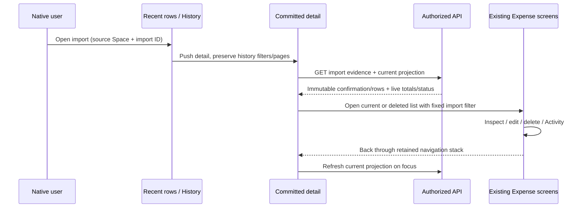

# Implementation Plan: Statement Import history and original/current Expense detail

## 1. Overview

- **Objective:** Complete [issue #155](https://github.com/yororo/spendeazy/issues/155), part of #140: open a successful Statement Import, inspect its original evidence and confirmation result, and follow its current or deleted Expenses.
- **Scope:** Extend existing history, recent rows, Dashboard navigation, committed detail read projections, mobile adapters and native screens. Reuse Expense browsing, detail, edits, soft deletion and Activity. Consume #153's existing immutable persistence and #151's existing recent-history integration.
- **Constraints:** Plan only. No parsing changes, PDF/password storage or upload, whole-import undo/deletion, restoration, new financial mutation API, SDK upgrade or retired web work. Preserve Space authorization, archive read-only behavior, exact PHP arithmetic and Asia/Manila confirmation dates. All paths below are repository-root-relative; files described as proposed do not yet exist.

## 2. Current State

- `api/src/statement-imports/application/statement-imports.service.ts`, `statement-import-cursor.ts` and `infrastructure/typeorm-statement-import-store.ts` already implement history with inclusive confirmation-date filters, descending `importedAt`/ID ordering, filter-bound version-2 cursors and page-size-plus-one reads. `importedAt` is the successful confirmation clock. History `expenseCount` is the current nondeleted count; it is not the original confirmed count.
- `presentation/space-statement-imports.controller.ts` exposes authorized collection/detail GETs. Detail already returns nullable immutable `confirmation` and `rows` via `ReviewedImportService.evidenceRows`. #153 persisted original controls, versions, reconciliation, original row evidence, included/excluded dispositions, confirmed values and original count/total. Legacy imports can lack these snapshots. Detail lacks current aggregate totals and row-to-Expense links/status.
- Expenses retain `statementImportId`, `sourceRowId`, optional `statementImportRowId`, soft deletion and Activity. Existing active/deleted Expense collection endpoints accept `statementImportId` and return totals and cursors. Activity has `edited` events, so reverted edits can remain distinguishable from never-edited Expenses.
- `mobile-app/src/api/statement-import-history-api-client.ts` supports only collection loading with page size 100 and optional cursor. `features/statement-import-history/use-statement-import-history.ts` handles basic Space loading and pagination but has no date filters or shared query-generation protection across refresh/append races. Its view's rows are not pressable and display device-local dates and Total Debit.
- `mobile-app/src/app/(app)/import-statement.tsx` already shows three recent imports and links to history. Dashboard's count links to unfiltered history even though `DashboardReport.summary.statementImports.filter` already supplies the reporting dates.
- Expense transport supports import filtering, but `features/expenses/browse-state.ts` and `use-expense-browse.ts` use a global date/Category/description selection without import scope. `use-expense-detail.ts` already handles edits/deletion, current Category/member labels and Activity; successful mutations invalidate lists through `noteManualExpenseSaved`. Expense route deletion returns with `router.back()`.
- Inspected design JSON: `mobile-app/design/mobile-design.pen`, `naq2A` → `UPHFB`, specifies provider/type icon wells, provider heading, Expense count/PDF metadata, importer/date, success and chevron. Its BDO AMEX/EastWest Visa examples are useful structure; PayPal/CSV is illustrative. `design/design-token.md` owns shared surfaces, typography, dark adaptations and accessible target sizes. History and committed detail have no dedicated boards.

## 3. Proposed Solution

Keep immutable evidence and live projections explicitly separate. Extend the existing detail GET rather than constructing totals from whichever Expense page happens to be loaded. Preserve `confirmation` and original row fields without rewriting them.

Proposed additive response fields:

| Surface | Fields and meaning |
| --- | --- |
| History item | Keep `expenseCount` with its documented current meaning; add nullable `originalExpenseCount` from stored confirmation, so recent rows can label the confirmed count correctly. Null means unavailable legacy provenance. |
| Detail | Add `currentExpenses: { count, totalAmount }`, representing all nondeleted Expenses in this import, independent of Expense-date/Category/search filters. Counts and PHP totals are decimal strings; empty is `0` / `0.00`. |
| Detail row | Add `expense: { id, edited, deletedAt } \| null` alongside original evidence and confirmed values. Excluded rows have null. Included rows link to retained active or deleted Expenses by same-Space provenance. `edited` means an `edited` Activity event exists; `deletedAt` independently signals deletion. |

Use a feature-owned read projection port/adapter for detail, composed in `statement-imports.module.ts`. Read import, safe evidence, linked Expense status and aggregates in one read-only repeatable-read transaction (or one SQL statement), so concurrent edits/deletion cannot produce internally inconsistent totals and statuses. Batch links and use `EXISTS` for edit Activity rather than joining every Activity into monetary aggregates. Reuse the existing evidence response allowlist; never expose reference HMACs, file hashes, operation request hashes or raw duplicate references. No schema change is expected.

Native detail presents metadata, **Original statement evidence**, **Originally confirmed Expenses**, and **Current Expenses** as separate sections. Original rows include excluded activity and confirmed values where present; original controls/reconciliation remain evidence, not spending totals. Current and deleted Expense actions open existing list/detail behavior with a fixed import scope. Resolve Category/person names from current authorized catalogs/membership and use Deleted user attribution for removed identities; label loading/failure separately from deleted attribution. Preserve IDs and original numeric/text values in immutable snapshots.

Research checked 2026-10-30: [PostgreSQL numeric types](https://www.postgresql.org/docs/current/datatype-numeric.html) supports exact monetary aggregation; [transaction isolation](https://www.postgresql.org/docs/current/transaction-iso.html) supports a consistent multi-query read snapshot. The [Expo SDK 58 Router reference](https://docs.expo.dev/versions/v58.0.0/sdk/router/) documents route parameters and focus effects used for explicit scope and return refresh. These support the proposed approach without new dependencies.

## 4. Implementation Tasks

### Task 1: Add consistent committed-detail projections

- **Goal:** Return immutable provenance and independently computed current state through the existing authorized GET.
- **Location:** `api/src/statement-imports/application/statement-import-store.ts`, `statement-imports.service.ts`, `reviewed-import.service.ts`; proposed feature-owned detail read port/adapter in the same application/infrastructure directories; `infrastructure/typeorm-statement-import-store.ts`; `statement-imports.module.ts`; `presentation/space-statement-imports.controller.ts`.
- **Changes:** Implement the fields in section 3. Reuse stored original totals, safe evidence serialization and confirmation time. Aggregate numeric amounts server-side with normalized two-decimal output, without floating-point conversion or narrowing aggregate precision to one Expense's limit. Match Expense links on Space/import/source row and stored row identity where available; never match by mutable description/date/amount. Derive edited status from retained edit Activity, including edited-then-deleted and reverted edits. Keep source-row order and all dispositions. Authorize archived read access, require the import to exist in the requested Space before returning rows/totals, and retain existing unavailable/not-found behavior. Add original count to history projection without accidentally selecting full evidence into collection responses. Keep original totals nullable for legacy imports; do not reconstruct them from current Expenses. Preserve collection ordering, date boundaries and cursor semantics.
- **Verification:** Focused service/adapter tests plus real PostgreSQL checks: 100.00/200.00 confirmed gives original 2/300.00; edit first to 150.00 and delete second gives current 1/150.00, with unchanged original rows/result. Revert/repeat edits retain edited status; deleting an edited Expense shows both indicators. All deleted gives current 0/0.00. Multiple Activity rows never multiply counts/totals. Confirm consistent detail during a concurrent mutation, same-Space joins and legacy null behavior.

### Task 2: Publish and decode the read contract

- **Goal:** Make the projections and history date filters usable through validated mobile adapters.
- **Location:** `api/src/statement-imports/presentation/statement-import-detail.dto.ts`, `statement-import-response.dto.ts`, `statement-import-response.mapper.ts`; `api/test/statement-imports.e2e-spec.ts`; generated `api/docs/openapi.yaml` and `openapi.json`; `mobile-app/src/api/statement-import-history-api-client.ts` and its test.
- **Changes:** Document section 3's fields, null semantics, exact values and unchanged confirmation-date filters. Extend mobile list input to an explicit query object with `fromDate`, `toDate`, cursor and bounded page size; update callers together. Add a detail method and nested runtime decoders for confirmation, original rows, dispositions, confirmed values, current aggregates and status links. Reuse compatible existing confirmation contract types without making the read model accept private request fields. Validate malformed IDs, dates, totals and nullable fields through the established request-failure boundary. Preserve legacy provider strings with a safe display fallback.
- **Verification:** HTTP schema and decoder fixtures cover mixed included/excluded evidence, legacy null confirmation, active/deleted links, malformed nested data and exact large amounts. Verify serialized filter/cursor parameters. Run `npm run openapi:generate` then `npm run openapi:check` in `api/` and review both artifacts.
- **Dependencies:** Task 1.

### Task 3: Complete filtered history and its entry points

- **Goal:** Make recent imports open detail and Dashboard history match the selected report period and Space.
- **Location:** `mobile-app/src/features/statement-import-history/`; `src/app/(app)/statement-import-history.tsx`, `import-statement.tsx`, `(tabs)/index.tsx`; `src/features/dashboard/dashboard-view.tsx`; proposed history workflow/reducer tests within the history feature.
- **Changes:** Add validated optional confirmation From/To date filters using existing field/sheet recipes and a clear-filters action. Default View all/Sharing history to all confirmation dates; keep recent integration unfiltered with its existing three-row presentation. Pass Dashboard's `summary.statementImports.filter` and source Space to history; use the report supplying the displayed count, not independently calculated month/year bounds. Validate route parameters before applying them. Do not apply another Space's route filters after a Space switch.
  Replace ad hoc asynchronous state with a scoped workflow/reducer keyed by identity generation, Space, normalized filters and operation ID. Filter/Space changes replace items/cursor immediately; refresh supersedes append, and all success/error/finally completions must match the current scope and operation. Guard A→B→A switching, sign-out and late pagination. Preserve list/filter state and scroll when opening/returning from detail. Support first-load, empty, filter-empty, retry, append-failure retry and refresh states.
  Make the shared recent/history row pressable using explicit source Space/import ID. Match `UPHFB` hierarchy with real BDO AMEX, EastWest Visa and GCash labels/type icons, PDF metadata, labeled original confirmed count (unavailable for legacy), current importer/date, success indicator and chevron. Use explicit Asia/Manila date formatting; no Total Debit as an Expense summary. Keep filename available in detail and accessible row labeling. Retain View all and existing archive messaging.
- **Verification:** Workflow tests exercise filter reset, late append after refresh/filter changes, A→B→A, session change, retries and retained return state. Navigation tests assert Dashboard passes exact API-provided dates/Space; View all is unfiltered and recent rows open the correct import. Native checks cover the provider row recipe and long labels.
- **Dependencies:** Task 2.

### Task 4: Build committed Statement Import detail

- **Goal:** Inspect successful original evidence and current projections with clear labels and safe navigation.
- **Location:** Proposed `mobile-app/src/app/(app)/statement-import/[statementImportId].tsx` and detail controller/view/workflow under `src/features/statement-import-history/`; `src/app/(app)/_layout.tsx`; existing theme/screen/surface/sheet components and Category/Space adapters.
- **Changes:** Require a valid source Space/import ID and gate requests/rendering against the current authorized Space/session; a mismatched route shows unavailable context rather than fetching the same ID in another Space. Show provider, Statement Type/account format, filename, applicable statement/history dates, Manila confirmation time, importer and destination Space. Display section 3's three financial/evidence sections, included/excluded original rows and confirmations, missing/unparseable controls as unavailable, reconciliation/partial-extraction diagnostics and independent edited/deleted indicators. Use progressive disclosure for long evidence and virtualize large row lists where needed; do not omit rows. Legacy detail explicitly states which original evidence/result is unavailable while retaining current Expense actions.
  Add loading, failure/retry, refresh and unavailable-record states. Refresh on focus after returning from Expenses, using session/query generation guards; refresh current labels as well as financial projections. Retain the navigation stack and history filters/scroll. Use shared accessible surfaces/typography with dark adaptation, growing text and status text/icons. Archived imports retain all inspection links, with a read-only notice and no mutation controls.
- **Verification:** Focused controller/view tests cover original versus current labels and values, overlapping status indicators, legacy missing evidence, 404, retry and stale response rejection. Navigate detail → Expense → edit/delete → Back and verify refreshed current state while original evidence and history return state remain intact.
- **Dependencies:** Tasks 2–3; Task 5 completes list actions.

### Task 5: Reuse Expense browsing with an isolated import scope

- **Goal:** Open all current/deleted Expenses for one import without silently inheriting unrelated filters.
- **Location:** Proposed `mobile-app/src/app/(app)/statement-import-expenses.tsx`; existing `src/features/expenses/use-expense-browse.ts`, `browse-state.ts`, `browse-workflow.ts`, `browse-view.tsx`; `src/api/expense-api-client.ts`; existing Expense detail route and `use-expense-detail.ts`.
- **Changes:** Add an explicit optional fixed scope to the reusable browse controller/workflow, including `statementImportId` and current/deleted mode in request/query identity. The import route owns local selection/scroll initialized with blank Expense dates, Category and description; it must not overwrite or read global tab filters. Keep import ID fixed, visibly identify the scope, and use existing active/deleted collection endpoints with normal pagination/totals. Bind scope to source Space/session and validate all route inputs. Existing general Expense browsing must retain its global selection behavior.
  Reuse existing Expense row/detail, edit/delete and Activity screens. Push detail normally so deletion returns to the import list and Back returns to committed detail then history. Reload import lists on return focus or existing mutation revision changes; refresh detail on focus. Preserve archive write restrictions and retained deleted Expense inspection. No restore/whole-import operations or mutation endpoint changes.
- **Verification:** Set unrelated global dates/Category/search first, then open both import lists and verify every matching active/deleted Expense is reachable across pages; other imports/Spaces are absent. Verify request/cursor identity, mutation invalidation, deletion return flow, archived inspection and unchanged global filters after leaving the import journey.
- **Dependencies:** Tasks 2 and 4.

### Task 6: Verify end-to-end history, retained evidence and native presentation

- **Goal:** Establish issue acceptance across HTTP/PostgreSQL and native navigation.
- **Location:** `api/test/statement-imports.e2e-spec.ts`, `expense-statement-import-space-postgres.e2e-spec.ts`, `dashboard-reporting-http-postgres.e2e-spec.ts`; focused mobile tests from Tasks 2–5; `mobile-app/design/design-token.md`, relevant feature README and implementation handoff report.
- **Changes:** Extend relevant existing suites rather than duplicate confirmation/recovery internals. Cover Manila midnight/inclusive date bounds, same-timestamp ID ordering, multi-page traversal, changed-filter cursor rejection and Dashboard/history agreement. Verify successful operation replay adds no import/count and deliberate reimport adds a distinct one. Exercise Shared archive, current Category/person rename and deleted identity attribution, original evidence retention and foreign-Space/unauthorized detail/list access. Record native design and return-journey evidence separately from automated checks; document the shared recipe adaptation without claiming dedicated mockup parity.
- **Verification:** Run the commands and manual checks in section 5, recording actual results and environmental blockers. All requirements in section 6 must have corresponding automated or native evidence.
- **Dependencies:** Tasks 1–5.

## 5. Testing and Validation

- Critical financial regression: confirm 100/200, edit first to 150, delete second; original stays 2/300.00 and current becomes 1/150.00. Verify original controls can differ from confirmed totals, excluded rows remain inspectable, edits/reverts/deletion do not change evidence, and overlapping indicators persist.
- Test exact centavos and large aggregate amounts, no-Expense totals, legacy missing snapshots, current names/Deleted user attribution, archived read-only flows, unauthorized/missing records and all pagination/query races specified above. Use fictional sanitized fixtures only.
- In `api/`: focused unit suites for changed read projections/cursors; `npm run test:e2e -- --runInBand --runTestsByPath test/statement-imports.e2e-spec.ts`; `npm run test:postgres` with all ten distinct disposable database URLs required by repository guidance; `npm run build`; read-only `npx eslint "{src,apps,libs,test}/**/*.ts"`; `npm run openapi:check` after generation. Include both import and Dashboard PostgreSQL suites through the required runner.
- In `mobile-app/`: add new core test files to the explicit `npm test` script, then run `npm test`, `npm run lint`, `npm run typecheck`. Parser internals are unchanged; run `npm run parser:test` if shared confirmation/evidence definitions or fixtures affect parser output.
- Native Android and physical iPhone, per `docs/local-testing.md`: recent → detail; Dashboard period → filtered history; active/deleted lists → Expense/Activity → edit/delete → Back. Check archive, loading/retry/unavailable, small displays, long filenames, large font scaling, light/dark contrast, screen-reader labels/focus and minimum accessible targets. Automated checks do not establish native visual acceptance.

## 6. Acceptance Criteria

| Observable result | Tasks |
| --- | --- |
| Recent rows open committed detail; View all opens full history with real provider/PDF presentation | 3–4 |
| Dashboard count opens its exact report-period/Space history; date filters reset pagination safely | 2–3, 6 |
| Descending confirmation/ID ordering, filter-bound cursors and stale-response isolation remain correct | 1–3, 6 |
| Detail identifies provider/type/file/dates/confirmation/importer/destination | 4 |
| Original controls/rows, original confirmed count/total and current nondeleted count/total are clearly separate | 1–2, 4, 6 |
| 2/300.00 remains original after edit/delete while current becomes 1/150.00; edited/deleted statuses can overlap and survive reversions | 1, 4, 6 |
| All import-scoped active/deleted Expenses remain reachable regardless of unrelated tab filters; existing Activity/edit/delete and return flow work | 4–5 |
| Manila confirmation dates drive history/reporting; replay counts once and deliberate reimport separately | 1, 3, 6 |
| Archived records retain current labels/Deleted user attribution and stay read-only; no undo/delete-import/restore action exists | 1, 4–6 |
| Loading/empty/failure/retry/unavailable states and post-mutation projection refresh work | 3–6 |
| OpenAPI/mobile adapters agree; relevant HTTP/PostgreSQL and native evidence establish totals, retention, boundaries and authorization | 2, 6 |

## 7. Assumptions and Open Questions

- #153's immutable entities and detail endpoint are already present in this checkout; implement #155 against inspected code rather than repeating plan 06's former missing-persistence work. No new persistence is needed for edited history because retained Activity is authoritative.
- Original confirmed count is the recent row's Expense count when available; legacy rows explicitly label original count unavailable and may show the separately labeled current count. Existing `expenseCount` contract semantics remain current.
- Preserve existing filter-bound history cursors; Space authorization applies on every request and mobile resets cursor on Space changes. A new cursor format or Space binding is unnecessary for this issue.
- A route pointing to a different active Space shows unavailable context with a return action; it must not automatically switch Space or reuse an import ID under another destination. Existing Space selection remains the way to enter archived history.
- Legacy records cannot supply immutable evidence that was never stored. Show that limitation explicitly, retain current browsing, and do not backfill fabricated confirmation results.
